<div align="center">



<br/>


</div>

---

## 👋 Hi, I'm Varnan

I'm a **solo-founder-turned-team-builder** and a third-year B.Com student at **Sri Aurobindo College, Delhi University**. I build software and AI products for **aviation training** — cabin crew academies, flight training organisations and aviation institutes across India — and I do **everything end to end**: product, code, design and sales.

I run **Ampyric**, where the idea is simple: *get people ready before they ever reach the sky.*

---

## 🚀 What I'm building

| Project | What it is |
| :-- | :-- |
| 🎙️ **[AI Mock Interview Simulator](https://github.com/VarnanGOAT/Mock-Interview-Simulator)** | Voice-based airline interview practice for cabin crew and ground staff aspirants — instant feedback, performance scoring and personalised coaching. Built for training academies, with white-label branding per institute. |
| ✈️ **CrewSim** | A 3D cabin crew training game in Three.js with voice input and AI-driven passenger interactions. |
| 🛫 **AeroDesk DCS** | An airport departure control system simulator for educational use. |
| 🧠 **Brain Super Intelligence** | An AI "company OS": a shared company brain with a team of department agents working on top of it. *(in progress)* |

---

## 🧰 How I work

```text
 Idea  ──►  Product  ──►  Code  ──►  Design  ──►  Sales  ──►  Support
   └──────────────  one person, one loop, fast iteration  ──────────────┘
```

- **Product-first.** I start from what a trainer or an aspirant actually needs, then build the smallest thing that does it well.
- **Ship, then iterate.** Many of my products have gone through dozens of versions based on real feedback from academy owners.
- **Built for white-labelling.** Every product is designed to carry an institute's own brand.
- **AI as a teammate.** I build with Claude Code and use AI throughout the product, not just in the demo.

---

## 🛠️ Toolbox


---

## 📈 Beyond code

- **Digital marketing.** Freelance SEO and growth work, including site audits, a React homepage rebuild, growth strategy and paid-social planning for a Gurugram-based recruitment platform.
- **Entrepreneurship.** Active in the Entrepreneurship Cell at Sri Aurobindo College, and recruiting student interns to learn on real projects.
- **Debate and diplomacy.** Model UN delegate.

---

## 🤝 Let's talk

If you run a training academy, or want to build something in aviation tech or AI-powered education, I'd love to hear from you.

[](mailto:jhavarnan03@gmail.com)

<div align="center">

<sub>Made by Varnan · Delhi NCR</sub>

</div>
