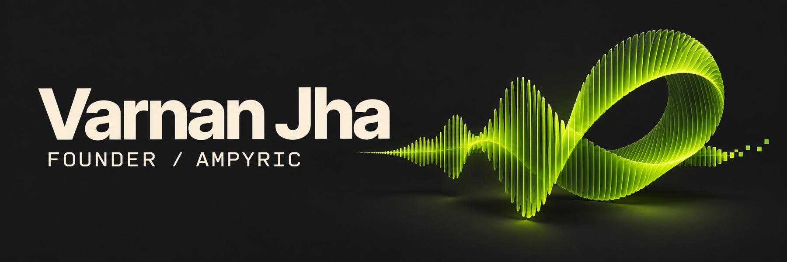

I’m **Varnan Jha**, founder of **Ampyric**. I build AI simulators that help cabin crew and ground staff practise interviews, in-flight situations and airport operations. I’m also building Brain SI, an AI operating system that runs company work with humans approving every decision, and Neighbouraction, I work across product, design, engineering and sales.

## Featured project

### AI Mock Interview Simulator

Cabin crew and ground staff candidates practise airline interviews out loud, then get a performance score, instant feedback and personalised coaching. Training academies can offer the simulator under their own brand.

**[Explore the repository →](https://github.com/VarnanGOAT/Mock-Interview-Simulator)**

## What I’m building

- **CrewSim** puts cabin crew trainees in a 3D cabin where they respond to AI-driven passengers using their voice. Built with Three.js.
- **AeroDesk DCS** simulates an airport departure control system so students can practise ground operations.
- **Brain Super Intelligence** is an in-progress workspace where AI agents for different departments work from shared company knowledge.

## How I work

I start with a task a trainer wants to teach or a candidate needs to practise. I build the first version around that task, then use feedback from academy owners to decide what to change. I work with JavaScript, React, Three.js and PHP.

I study commerce at Sri Aurobindo College, University of Delhi, and take on freelance SEO and growth work.

## Get in touch

If you run an aviation academy or are building tools for aviation training, [email me at jhavarnan03@gmail.com](mailto:jhavarnan03@gmail.com).

*Delhi NCR, India*
